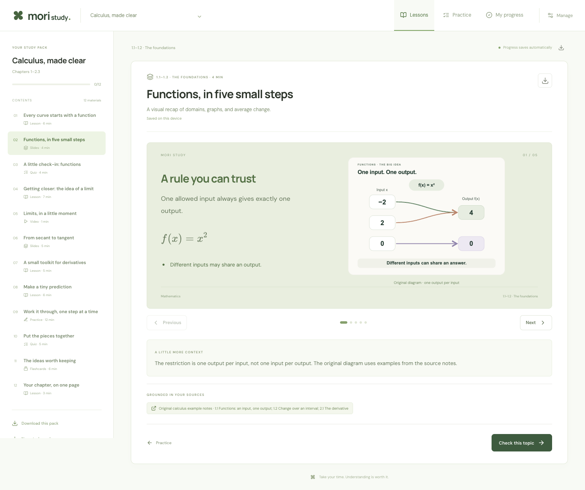

<p align="center"><strong>Mori Study</strong></p>
<h1 align="center">Your sources. Your pace. Your study space.</h1>
<p align="center">An open-source study portal and portable skill for AI coding agents.</p>
<p align="center">Local first · No account · No model API key · MIT</p>

Mori Study turns a conversation with your existing AI agent into a place to learn. Give your agent a textbook, class slides, photos, or notes and tell it what you need. It understands your goal and scope, creates the material with its own model, and opens the result in a calm, interactive Next.js portal.

> “Use Mori Study with these calculus notes. Make picture-led slides and worked practice for chapters 1–2.3. Keep the slides brief and put the explanation in notes.”

The **agent understands, reads, and creates; Mori Study validates and serves**. Ask for a lesson, slides, a quiz, practice problems, flashcards, a short video, or several together. Useful pictures take priority in slides, with minimal visible text and detail in notes. A portal upload or form is optional; you can start entirely in the agent conversation.

[Introduction website](https://user-github-me.github.io/mori-study/) · [Agent install guide](INSTALL.md) · [Releases](https://github.com/user-github-me/mori-study/releases)



## Give this repo to your agent

Copy this into Codex, Claude Code, or another agent with terminal access:

> Use https://github.com/user-github-me/mori-study as my study helper. Read its INSTALL.md and set up Mori Study locally. First understand what I want to learn from my attached sources and which formats I need. Create the material with your own model, use useful pictures and minimal text in slides, then validate, import, and open my study pack.

Agents: start with [INSTALL.md](INSTALL.md). If this repository is already checked out, reuse it. A fresh clone plus the commands below is enough; no model key or hosted account is required.

## Start locally

Requires **Node.js 22.16+** and npm. Create a study workspace with:

```sh
npx mori-study init my-study
```

Or run from source:

```sh
git clone https://github.com/user-github-me/mori-study.git
cd mori-study
npm install
npm run mori-study -- install --agent all
npm run mori-study -- open
```

The portal opens at **http://127.0.0.1:3000**. Original sample study packs are included so you can try every study format immediately. To run the development server in your current terminal instead:

```sh
npm run dev
```

Open this checkout in your agent, then invoke **`$mori-study`** in Codex or **`/mori-study`** in Claude Code. You can also ask the agent to read [skills/mori-study/SKILL.md](skills/mori-study/SKILL.md) directly. A file-based agent with shell and filesystem access can follow the same workflow; image interpretation depends on the agent's capabilities.

For a global skill installation that points back to this checkout:

```sh
npm run mori-study -- install --agent all --global
```

## Install a release package

This command installs from the exact GitHub release asset:

```sh
npx --yes --package=https://github.com/user-github-me/mori-study/releases/download/v0.1.0/mori-study-0.1.0.tgz mori-study init my-study
```

The lightweight `mori-study` launcher creates a local portal, installs dependencies and agent skills, then opens it. `--no-install`, `--no-open`, and `--agent codex|claude|all|none` support automated setup. It refuses to overwrite existing work. You can also download the tarball from [Releases](https://github.com/user-github-me/mori-study/releases) and use it offline after dependencies are available.

The published package and CLI are both **`mori-study`**. Create a workspace with `npx mori-study init my-study`. Inside an existing workspace, use `npm run mori-study -- <command>`. The Git clone and versioned GitHub release installers are also available.

## How it works

1. **Give your agent the sources and request.** Attach PDFs, images, text, Markdown, or documents and describe what you need. Adding sources through the portal is optional.
2. **Let it understand your intent.** The agent identifies the learning goal, chapter range, depth, and requested formats. It asks about gaps that matter and proceeds when your request is clear.
3. **Create, validate, and serve.** Your agent reads the sources and uses its own model to make the material. Mori Study checks the content structure, imports it, and serves the local study pack. Source accuracy remains the agent's responsibility.
4. **Study at your pace.** Read lessons, present visual slides, answer quizzes, work through practice with hints and solutions, review flashcards, and play videos. Progress stays in your browser.
5. **Take it with you.** Export the whole study pack as PowerPoint, JSON, or Markdown; download flashcards as an Anki-compatible CSV; or use print views to save a PDF. Back up and restore study progress as JSON. PowerPoint embeds slide images; keep original documents and video files separately.

No new API key is needed by Mori Study. Your agent uses its existing subscription or model configuration.

## Built for learning

| Format     | Study experience                                               |
| ---------- | -------------------------------------------------------------- |
| Lessons    | Clear Markdown, mathematical notation, source references       |
| Slides     | Useful pictures, minimal visible text, and explanatory notes   |
| Quizzes    | Multiple-choice practice, immediate explanations, saved scores |
| Practice   | Open-ended problems, optional hints, and worked solutions      |
| Flashcards | Flip-to-reveal practice and saved review progress              |
| Videos     | MP4 playback with a transcript; local HyperFrames generation   |

The personal portal opens directly into your current study pack. **Lessons, Practice, and My progress** are the three main views; your exact place and unfinished answers save automatically. **Manage** holds the source library, study-set search, requests, imports, exports, and progress backups. The bundled calculus content is original example material, clearly separate from your own uploads.

## Take the whole pack into PowerPoint

The **PowerPoint (.pptx)** export turns the complete study pack into a presentation: lessons, slides, quiz questions and answers, practice problems and worked solutions, flashcards, video references, and sources. Text stays editable, local slide images are embedded, and notes retain explanations and source references. Pictures and rendered equations are image elements; video files remain separate from the deck.

The skill prioritizes a dominant useful picture per teaching slide: a source figure, precise graph, diagram, or annotated example. Explanatory detail belongs in notes. Images carry alt text and optional captions/credits. The agent chooses source crops, draws accurate diagrams, or uses an image tool already available to it; the exporter arranges that content without generating new material. Remote image URLs are not fetched by the exporter. See the skill's [visual deck guide](skills/mori-study/references/visual-slides.md).

## Make a study video

Mori Study includes a reusable [HyperFrames](https://github.com/heygen-com/hyperframes) template. Its default output is a **silent, editable typography explainer** with a transcript and WebVTT file. The included 30-second limits example can be recreated from its scene spec:

```sh
npm run video -- examples/limits.video.json --out videos/limits
npm run video -- examples/limits.video.json --out videos/limits \
  --render --output public/videos/limits.mp4
```

Rendering needs **FFmpeg**. The helper downloads the pinned HyperFrames CLI/browser on first use when needed, checks the composition, and renders locally. HTML generation itself uses local assets. Narration, image generation, and hosted rendering are optional extensions; they are not included services. See [the video guide](docs/VIDEOS.md).

## Agent interface

```sh
npm run mori-study -- sources
npm run mori-study -- inspect SOURCE_ID
npm run mori-study -- validate course.json
npm run mori-study -- import course.json
npm run mori-study -- export COURSE_ID --format markdown --out course.md
npm run mori-study -- export COURSE_ID --format pptx --out study-pack.pptx
```

The course contract is in [src/lib/types.ts](src/lib/types.ts), with runtime checks in [src/lib/schema.ts](src/lib/schema.ts). The [skill](skills/mori-study/SKILL.md) teaches agents intent discovery, source reading, format choices, visual slides, and validation. For an optional portal request, read it with `requests REQUEST_ID`, then add `--request REQUEST_ID` to `import`. See [the architecture](docs/ARCHITECTURE.md) for the CLI, API, and storage layout.

## Data and current scope

- Courses, sources, uploads, and study requests are stored under `data/`, excluded from version control. Set `MORI_DATA_DIR` to use a different location.
- Study progress is saved in browser local storage. It is specific to that browser and portal address; use the progress backup before clearing site data.
- Mori Study is designed for one local user. The server binds to loopback by default and has no authentication or shared-user isolation.
- Text extraction works for machine-readable PDFs, DOCX, and PPTX. Photos, scanned PDFs, diagrams, and document formatting may need your agent's vision or document tools. Uploading a file is not a guarantee that its contents were extracted.
- Courses are generated by the agent you already use. Source grounding and JSON validation improve reliability; academic correctness still needs review.

## Develop and contribute

```sh
npm run typecheck
npm test
npm run build
npm run test:browser
```

Build distribution artifacts with `npm run package:build` and the introduction site with `npm run build:site`. See [the release guide](docs/RELEASING.md) for GitHub releases, Pages, and optional npm trusted publishing.

See [CONTRIBUTING.md](CONTRIBUTING.md). Useful next contributions include accessible study formats, additional document adapters, richer HyperFrames scenes, and better agent interoperability.

Mori Study's code and original demo materials use the [MIT license](LICENSE). Third-party dependencies and bundled assets retain their own licenses; see [notices](docs/THIRD_PARTY.md).
